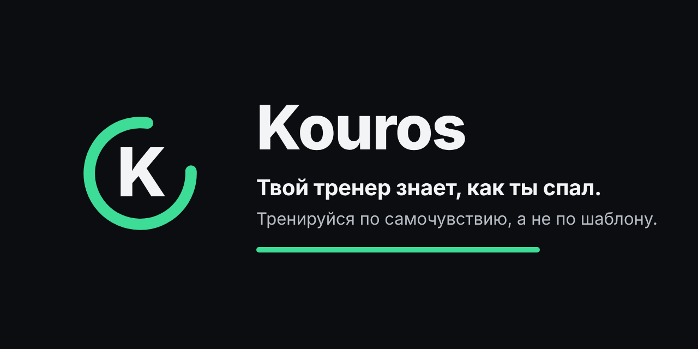
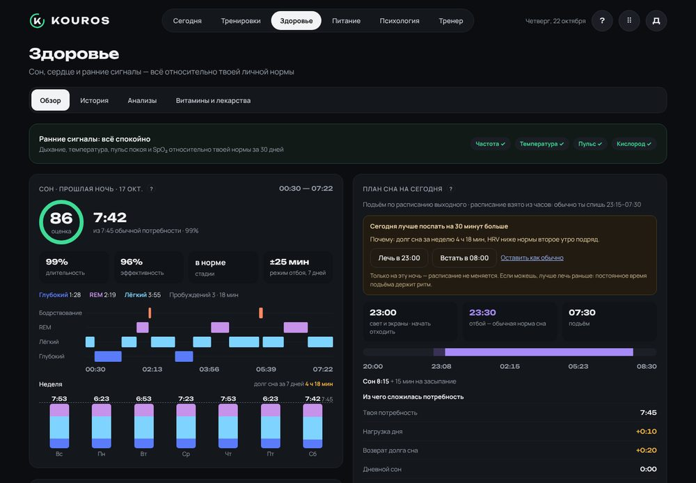
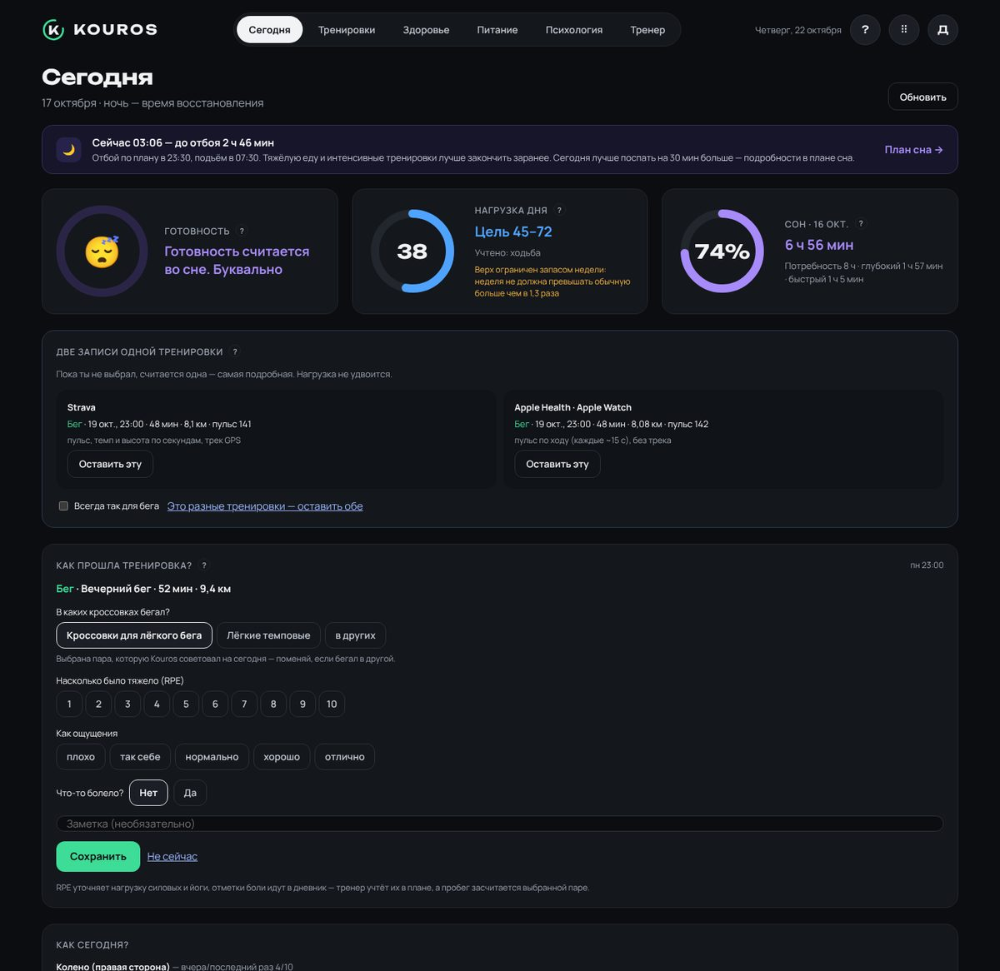
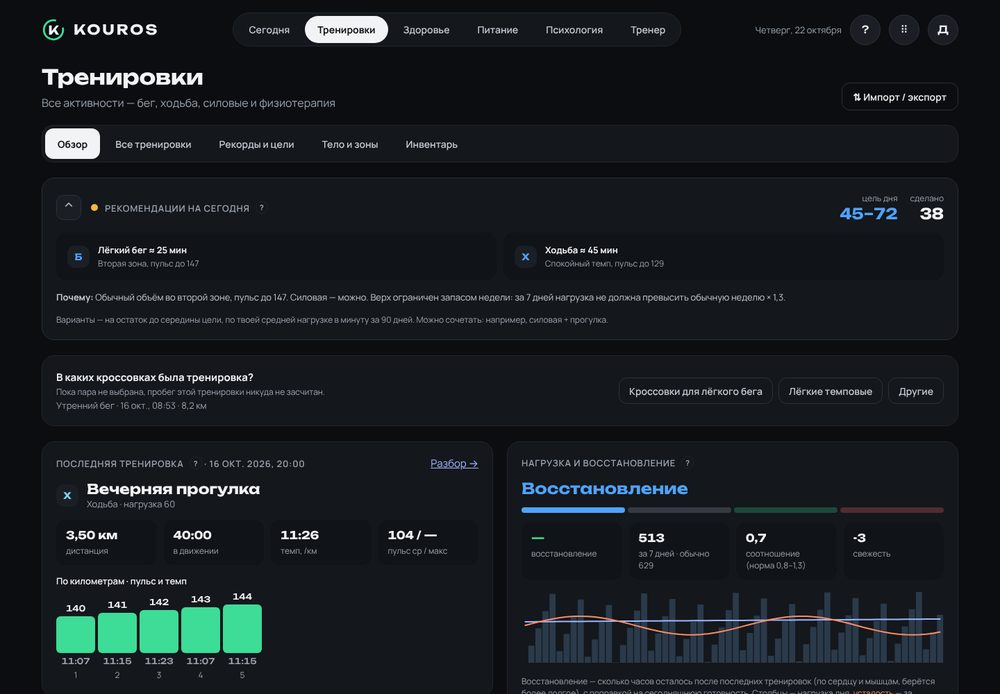
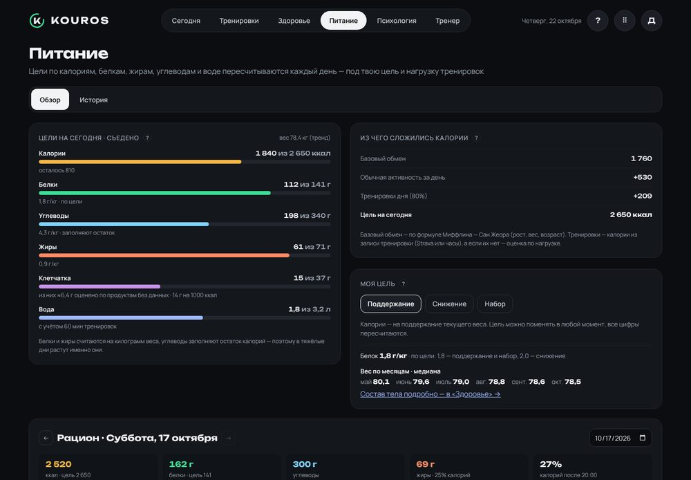
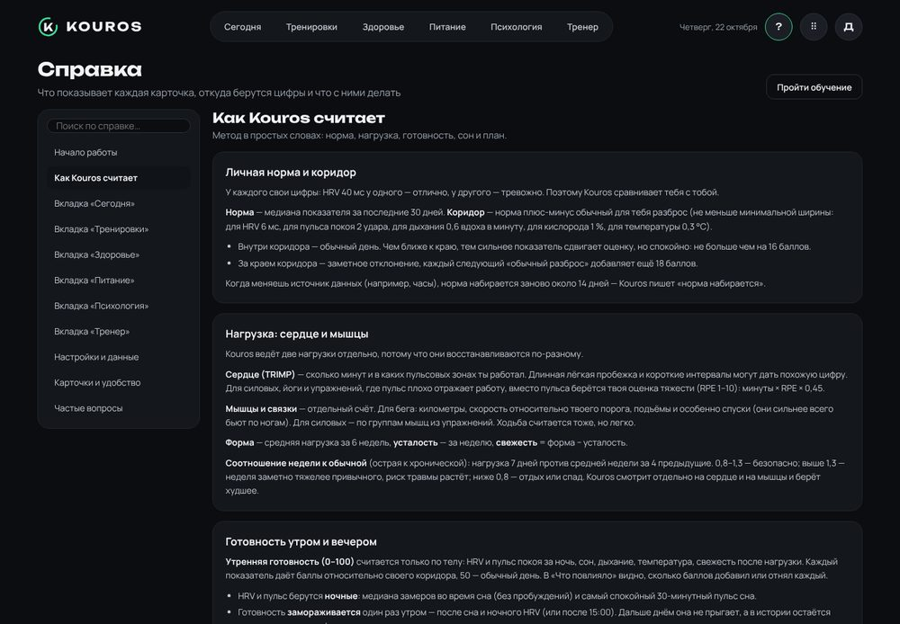

<p align="center"></p>

<p align="center"><b>Kouros знает, как ты спал, и меняет план под тебя.</b><br>
Тренировки, сон, пульс, HRV, питание, витамины и самочувствие — в одном месте. Kouros сам считает нагрузку, готовность и восстановление и каждый день подсказывает, сколько и как тренироваться. Все данные остаются на твоём компьютере.</p>

<p align="center">


</p>

<p align="center">
<a href="#-скачать">Скачать</a> ·
<a href="#-что-умеет">Что умеет</a> ·
<a href="#-как-kouros-считает">Как считает</a> ·
<a href="#-первый-запуск">Первый запуск</a> ·
<a href="#-приватность">Приватность</a> ·
<a href="#-вопросы">Вопросы</a> ·
<a href="#-для-разработчиков">Для разработчиков</a>
</p>

<p align="center"></p>

> [!IMPORTANT]
> Kouros — **не медицинское изделие**. Он не ставит диагнозов и не заменяет врача или тренера: все подсказки о здоровье, анализах и лекарствах сводятся к «обрати внимание» и «обсуди с врачом».

---

## 💡 Почему Kouros

- **Сравнивает тебя с тобой.** Почти всё оценивается относительно твоей личной нормы за 30 дней, а не «среднего человека». 50 — твой обычный день.
- **Объясняет каждую цифру.** У готовности видно, какой показатель сколько баллов добавил. У совета по кроссовкам — каждый плюс и минус. У плана — почему день поменялся.
- **Считает код, а не нейросеть.** Формулы одинаковые каждый день и открыты в исходниках.
- **Всё в одном.** Бег, силовые и мышцы, сон, стресс, еда и микроэлементы, витамины и лекарства, анализы, психология, план и кроссовки — и всё это связано между собой.
- **Данные не уходят из дома.** Зашифрованная база на твоём компьютере. Ни аккаунта, ни облака, ни аналитики.
- **Последнее слово за тобой.** Kouros предупреждает и предлагает вариант полегче, но выбирает тренировку человек.

## 📥 Скачать

1. Открой [последний релиз](../../releases/latest) и скачай `Kouros_<версия>_x64-setup.exe`.
2. Запусти установщик. Если Windows покажет «Windows защитил ваш компьютер» — **Подробнее → Выполнить в любом случае** (у программы нет платного сертификата издателя).
3. Дальше Kouros обновляется сам: проверяет новую версию раз в 12 часов и ставит её одной кнопкой, проверяя подпись. Данные при обновлении сохраняются.

Нужны Windows 10 или 11 (64 бита) и WebView2 — он уже есть в современных Windows.

## ✨ Что умеет

### ☀️ Сегодня — всё, что нужно решить сегодня
- **Готовность 0–100** утром и вечером — по ночному HRV, пульсу покоя, сну, дыханию, температуре и свежести после нагрузки. «Что повлияло» раскладывает её по баллам.
- **Тренировка дня по готовности** — от интервалов до отдыха, с объёмом в минутах и нагрузке.
- **Тренировка по плану** — «Подтверждаю» или «Выбрать другое». Рискованный выбор Kouros проверит, предложит вариант полегче и сам пересчитает неделю.
- **Кроссовки на сегодня** — два касания (температура и дорога), и Kouros советует пару с объяснением.
- **Опрос после тренировки** — пара кроссовок, тяжесть, ощущения и боль за 15 секунд.
- Риск травмы, восстановление в часах, стресс, сон и долг сна, витамины на сегодня, напоминания с переходом к причине.

### 🏃 Тренировки
- Загрузка из **Strava** и/или из часов через **freddy** (Apple Watch, Garmin, Suunto…). Повторы одной тренировки находятся сами, нагрузка не удваивается.
- **Две нагрузки**: на сердце (TRIMP по пульсовым зонам или по тяжести 1–10 для силовых) и отдельно на мышцы и связки — с учётом скорости, подъёмов и спусков. Форма, усталость, свежесть, соотношение недели к обычной.
- Страница тренировки: графики с общим курсором, карта маршрута (OpenStreetMap по желанию), отрезки, зоны, мышечная нагрузка, восстановление.
- **Силовые по подходам** с библиотекой почти из 900 упражнений (анимация, мышцы, подсказки по-русски). Свой вес в отжиманиях и подтягиваниях и резинки-эспандеры считаются в нагрузку сами. **Карта мышц** — что загружено сейчас.
- Рекорды и прогнозы на дистанции, беговая толерантность, интенсивность по неделям.
- **Кроссовки**: пробег по выбранной паре, ресурс, характеристики (вставь таблицу из обзора — Kouros разберёт её сам), мембрана, совет на день.

### 💤 Здоровье
- Сон по стадиям, оценка ночи, **личная потребность во сне**, долг и план «лечь раньше / встать позже» на сегодня.
- Ночные HRV, пульс покоя и кислород с коридорами нормы, **ранние сигналы** болезни по дыханию, температуре и пульсу.
- Стресс днём по пульсу и HRV в спокойные минуты.
- Привычки, алкоголь и кофеин — и их влияние на твой HRV наутро; калькулятор восстановления после алкоголя.
- **Анализы**: PDF из лаборатории читается прямо на компьютере; ~55 показателей с подсказками для тренировок и питания.
- **Витамины и лекарства**: каталог добавок, поиск в базе NIH, реестр лекарств РФ; верхние безопасные пределы, время приёма и сочетания, лекарства, важные для спорта, личный эффект на HRV и сон.

### 🥗 Питание
- Цели на день по калориям, БЖУ, клетчатке и воде — под тренировки и цель по весу.
- **22 витамина и минерала** с нормами России, ЕС, США, ВОЗ и других стран. Если в YAZIO записаны только калории, Kouros оценит микроэлементы по справочнику и почти 200 русским блюдам (с пометкой «≈»).
- Режим питания, качество рациона, **возможная нехватка** витаминов и минералов с подсказкой, какой анализ сдать.

### 🧠 Психология
- Индекс Хупера каждое утро, TQR перед тренировкой, BRUMS и опрос стресса и восстановления раз в неделю.
- Самочувствие показано **рядом** с готовностью тела, а не внутри неё — видно, когда голова и тело расходятся. Опросы могут только облегчить план.

### 🎯 Тренер
- Знакомство из 5 шагов → **план на 3 недели** с блоками и разгрузкой, разминкой, основной частью по твоим зонам и заминкой.
- «Как мой день?» и анализ недели — короткие отчёты по правилам.
- Замены, когда мешают готовность, боль, незапланированная тренировка, свежий анализ или лекарство.
- **Дневник боли** на фигуре, **возврат к бегу** после травмы по шагам, цель на забег с прогнозом и контрольными тестами.
- **«Спросить Claude»**: Kouros готовит сводку, ты вставляешь её в свой чат с Claude, а ответ — с изменениями плана, составом добавки или результатами анализов — обратно.

### 🧭 Удобство
- **Справка** с поиском, знак «?» у сложных карточек и короткое обучение при первом запуске.
- Карточки можно **перетаскивать** — раскладка своя для каждой вкладки.
- Ссылки «→» ведут прямо к нужной карточке на другой вкладке.
- Масштаб интерфейса (Ctrl + колесо), вход по Windows Hello.

<table>
<tr>
<td></td>
<td></td>
</tr>
<tr>
<td></td>
<td></td>
</tr>
</table>

<sub>На снимках — демонстрационные данные.</sub>

## 🧮 Как Kouros считает

```
Strava ──────────┐              ┌──────── движок (Rust) ────────┐
freddy ──────────┤              │ норма и коридоры · нагрузка   ├─► экраны, план,
iPhone (HAE) ────┼─► Kouros ───►│ готовность · сон · питание    │   подсказки
файлы  ──────────┘ (зашифр. база)
                              └───────────────────────────────┘
```

| Что | Как |
| --- | --- |
| **Норма** | Медиана за 30 дней. Коридор — плюс-минус твой обычный разброс. Внутри коридора показатель двигает оценку плавно (до ±16), за краем — сильно. |
| **Нагрузка на сердце** | TRIMP по времени в пульсовых зонах; для силовых и йоги — минуты × тяжесть 1–10. Форма (6 недель), усталость (неделя), свежесть. |
| **Нагрузка на мышцы** | Отдельно: километры × скорость относительно порога, подъёмы и спуски; силовые — по группам мышц из упражнений. |
| **Риск** | Неделя против средней за 4 предыдущие — отдельно для сердца и мышц. 0,8–1,3 — безопасно. |
| **Готовность** | Только тело: ночные HRV и пульс, сон, дыхание, температура, свежесть. Фиксируется утром; вечером — ± итог дня. |
| **План дня** | Ступень по готовности + запреты на интенсив (тяжёлая неделя, вчерашний тяжёлый день, признаки болезни). Опросы только облегчают. Верх — порог недели. |
| **Сон** | Своя потребность по ночам, после которых HRV и пульс в норме; долг только за заметно короткие ночи. |
| **Питание** | Миффлин — Сан Жеор + активность + 80 % тренировок ± цель; белок и жиры на кг, углеводы — остаток. |

Подробно — во встроенной справке, глава «Как Kouros считает».

## 🚀 Первый запуск

1. **Профиль** — «Настройки → Профиль и зоны»: год рождения, рост, пол, **максимальный пульс** и **пороговый темп**. Если был лабораторный тест — возьми зоны оттуда.
2. **Strava** — «Настройки → Синхронизация»:
   - создай своё приложение на [strava.com/settings/api](https://www.strava.com/settings/api) (Website — `http://localhost`, Authorization Callback Domain — `localhost`);
   - впиши в Kouros Client ID и Client Secret и нажми «Подключить Strava».
3. **Здоровье** (по желанию — сон, пульс, HRV, вес, еда, вода) — один из двух путей:
   - **Health Auto Export** на iPhone — данные Apple Health прямо на компьютер по домашнему Wi-Fi, без посредников (см. ниже);
   - **freddy** — подключи устройства на [freddy.coach](https://freddy.coach), создай API-ключ и впиши его в Kouros. Через freddy работают и Garmin, Suunto, Fitbit.

   Для каждого вида данных можно выбрать свой источник.
4. **Тренер → знакомство** — цели, режим, дни, травмы, чем восстанавливаешься. Из этого строится план.
5. По желанию: кроссовки и резинки («Тренировки → Инвентарь»), витамины («Здоровье → Витамины и лекарства»), анализы («Здоровье → Анализы»).

Дальше Kouros работает сам: каждые 20 минут забирает новые данные и пересчитывает всё. Короткое обучение запустится при первом входе, справка — кнопка «?» в шапке.

### 📱 Health Auto Export: Apple Health без посредников

[Health Auto Export](https://apps.apple.com/app/id1115567069) — приложение для iPhone (автоматизации — в платной версии). Оно каждые полчаса отправляет данные Apple Health прямо в Kouros по домашней сети.

1. В Kouros: «Настройки → Синхронизация → Health Auto Export» → «Включить приём с iPhone». Если Windows спросит про доступ к сети — разреши для частных сетей.
2. Наведи камеру iPhone на QR-код в карточке — страница «Всё работает» значит, что телефон видит компьютер.
3. В Health Auto Export: «Автоматизации» → новая → **REST API**. URL — адрес из Kouros (ключ уже внутри), «Показатели здоровья» — **все** (Kouros сам возьмёт нужное), JSON, **Суммировать данные — выкл**, пакетные запросы — вкл, раз в 30 минут.
4. После первой отправки Kouros покажет, что пришло, и подскажет, если чего-то важного не хватает.
5. История — «Ручная загрузка» в Health Auto Export (лучше по неделе) → «Загрузить выгрузку…» в Kouros.
6. Когда данные пришли — «Перейти на Health Auto Export».

Телефон в другой сети? Сохраняй выгрузки в Google Drive, Dropbox или iCloud Drive и укажи эту папку в Kouros. Подробно — во встроенной справке.

## 🔒 Приватность

- **База зашифрована** (SQLCipher, AES-256) и лежит в `C:\Users\<имя>\Kouros\`. Ключ базы и ключи Strava и freddy — в Диспетчере учётных данных Windows, не в файлах.
- **Наружу** Kouros обращается только к Strava и freddy (забрать твои данные), GitHub (есть ли новая версия) и, если включишь, к картам OpenStreetMap и открытым справочникам (NIH — добавки, RxNav — группы лекарств, grls.rosminzdrav.ru — реестр лекарств). Уходит только текст поиска — никаких личных данных.
- **Health Auto Export** присылает данные внутри домашней сети, на адрес с ключом; без интернета и облака.
- **Нет** аккаунта, облака, аналитики, трекеров и удалённых шрифтов.
- Сводка для Claude копируется только по твоей кнопке, и вставляешь её ты сам.

| Папка | Что внутри |
| --- | --- |
| `kouros.db` | Вся история (зашифровано) |
| `files\` | Импортированные тренировки и PDF анализов |
| `backups\` | Резервные копии — раз в день, последние 14 |
| `exports\` | Выгрузки CSV / GPX |
| `inbox\` | Только что присланное с iPhone — разбирается и удаляется сразу |

Для переноса на другой компьютер нужен **ключ восстановления**: «Настройки → Данные и безопасность».

## ❓ Вопросы

<details><summary><b>Нужен ли Strava Premium или платный freddy?</b></summary>
Kouros работает с обычным аккаунтом Strava через его открытый API. Условия freddy смотри на сайте сервиса. Без freddy и без Health Auto Export Kouros работает только с тренировками (без сна, пульса покоя, еды). Health Auto Export — платное приложение для iPhone; его условия смотри в App Store.
</details>

<details><summary><b>Почему утром нет готовности?</b></summary>
Ночные замеры ещё не дошли: iPhone не отправил их из Apple Health во freddy. Открой «Здоровье» на iPhone, подожди и нажми «Обновить». После 15:00 готовность считается по тому, что есть.
</details>

<details><summary><b>Есть версия для Mac, Android, iPhone?</b></summary>
Сейчас только Windows. Версия для iPhone в работе: с прямым чтением Apple Health и синхронизацией с компьютером по домашнему Wi-Fi — без облака.
</details>

<details><summary><b>Это медицинский прибор?</b></summary>
Нет. Kouros сравнивает показатели с твоей нормой и нормами лабораторий и подсказывает, на что обратить внимание. Диагнозы, лечение и дозировки — только с врачом.
</details>

> [!NOTE]
> Kouros — независимый проект, не связанный со Strava, Apple, Garmin, freddy, Anthropic или производителями добавок. Каталог добавок собран из открытых источников и может отличаться от этикетки твоей банки — Kouros всегда просит сверить состав.

## 🛠 Для разработчиков

| Часть | Где |
| --- | --- |
| Интерфейс — React 18, TypeScript, Vite | `src/` (`npm run dev` — демо в браузере на вымышленных данных) |
| Приложение — Tauri 2, Rust | `src-tauri/` |
| Формулы (без внешних библиотек) | `src-tauri/src/engine/` |
| Чтение FIT/TCX/GPX/CSV и PDF анализов | `src-tauri/src/parse/` |
| База — SQLCipher, миграции | `src-tauri/src/db.rs` |
| Справка | `src/help/content.ts` |
| Каталог добавок и реестр лекарств | `tools/catalog/build.py` → `src-tauri/resources/` |
| Библиотека упражнений | `tools/exercises/build.py` ([Free Exercise DB](https://github.com/yuhonas/free-exercise-db), Unlicense) + `tools/exercises/ru.tsv` |

Сборка: push в любую ветку — проверка (`check.yml`), push в `main` — подписанный установщик в Releases (`build.yml`).

Локально (Node 22, Rust, WebView2):

```
npm install
npm run tauri dev
```

## 📄 Лицензия

Исходный код открыт для чтения. Лицензия на использование пока не выбрана — все права у автора. Библиотека упражнений — общественное достояние (Unlicense).
